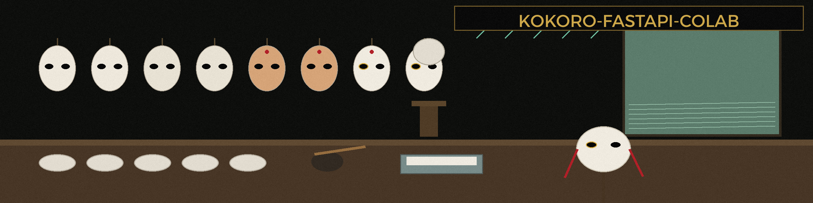

# Kokoro-FastAPI-Colab

A ready-to-run Google Colab notebook for deploying Kokoro text-to-speech API with GPU acceleration and public access via an ngrok tunnel.

## Features

- One-click launch of Kokoro TTS API on Google Colab with T4 GPU
- Automatic ngrok tunnel creation for public access (the notebook contains no Cloudflare code; an earlier version of this README claimed Cloudflare, which was wrong and is now corrected)
- Compatible with SillyTavern and other applications as an OpenAI-compatible TTS endpoint
- Optional static domain: set `NGROK_CUSTOM_DOMAIN` in the notebook's configuration cell to a reserved ngrok domain; the notebook falls back to a standard ngrok URL if the custom domain fails
- Pre-configured with all necessary setup steps

## Quick Start

Click the button below to open this project in Google Colab with T4 GPU acceleration:

## Usage

> **Workshop note pinned to the peg board.** Tunnel addresses change at every restart, and a restarted session mints a new one. Copy the address whole, every character.

1. Click the "Open In Colab" button above
2. In Colab, go to Runtime → Change runtime type and select "T4 GPU"
3. Set `NGROK_AUTH_TOKEN` in the notebook's configuration cell to your ngrok auth token (the placeholder value is rejected by the notebook with a clear error)
4. Run the notebook
5. The notebook will set up Kokoro TTS and create a public URL via ngrok
6. Use the generated URL in SillyTavern or other applications

## Verified behaviour and limits

The notebook file (`launch_kokoro.ipynb`, 4 cells) was inspected and parsed as valid JSON in this pass: one markdown intro, one code cell that installs `requests`, `loguru`, and `pyngrok`, clones `remsky/Kokoro-FastAPI`, starts its GPU server on port 8880, waits up to 180 seconds for the API, tests it, then opens the ngrok tunnel, plus a browser-console keep-alive snippet and the ngrok guide. The notebook was not run live in this pass: a live run needs Google Colab with a T4 GPU and a real ngrok token, neither of which was used here, so GPU start-up, model download, and tunnel creation are as coded, not as observed. The keep-alive JavaScript snippet is also unverified against the current Colab interface.

## Guide for Creating a Free Custom Static Ngrok Domain, Creating a Free Account, and Getting the Auth Token

### Step 1: Create a Free Ngrok Account
1. Go to the [ngrok website](https://ngrok.com/).
2. Click on the "Sign Up" button.
3. Fill in the required information to create a free account.
4. Verify your email address if required.

### Step 2: Get Your Ngrok Auth Token
1. Log in to your ngrok account.
2. Go to the "Auth" section in the dashboard.
3. Copy your auth token from the provided field.

### Step 3: Create a Free Custom Static Ngrok Domain
1. In the ngrok dashboard, go to the "Reserved" section. [ngrok domain section](https://dashboard.ngrok.com/domains)
2. Click on "Reserve a Domain".
3. Choose a subdomain name and reserve it
4. Your custom static ngrok domain will be something like `your-subdomain.ngrok.io`.

### Step 4: Set Up Ngrok in the Notebook
1. In the code cell at the top of this notebook, set the `NGROK_AUTH_TOKEN` variable to your auth token.
2. Set the `NGROK_CUSTOM_DOMAIN` variable to your reserved custom domain (optional).
3. Run the notebook to start the Kokoro FastAPI server with ngrok tunnel.

## License

See the [LICENSE](LICENSE) file for details.
